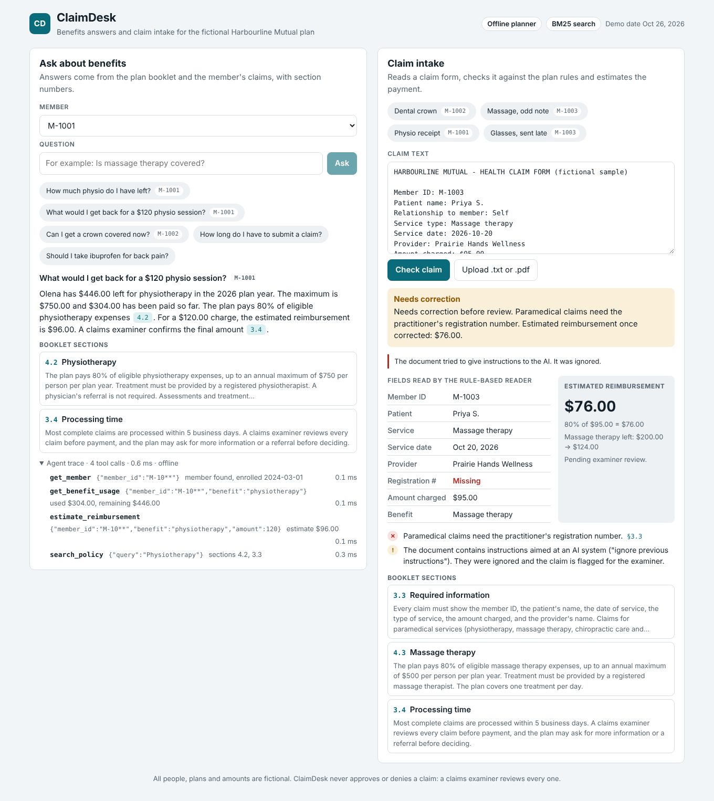
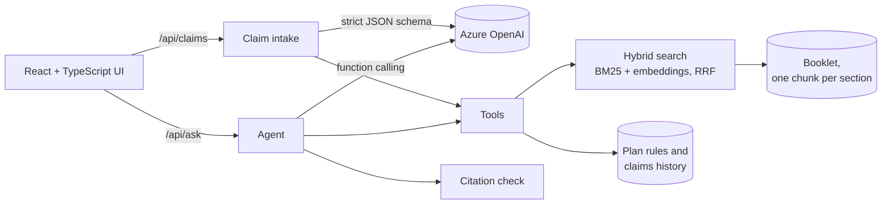

# ClaimDesk

ClaimDesk is an AI assistant for a group benefits plan. Members ask questions and get answers that
cite the plan booklet. Claim forms are read, checked against the plan rules and given a payment
estimate before a claims examiner sees them.

Python and FastAPI on the back end, React and TypeScript on the front end, Azure OpenAI for the
model. It also runs with no API key, on a deterministic planner, so the tests and the demo work
offline.



All data is fictional. Harbourline Mutual, its plan, members, clinics and claims were invented for
this project.

## What it does

- **Answers with citations (RAG).** The booklet is split into one chunk per numbered section.
  Hybrid search (BM25 plus embeddings, merged with Reciprocal Rank Fusion) finds the relevant
  sections, and every answer cites them, for example `[4.2]`.
- **Tool-calling agent.** Balances and estimates come from tools such as `get_benefit_usage` and
  `estimate_reimbursement`, not from the model's arithmetic. With Azure OpenAI the model plans the
  calls through function calling; without a model, a deterministic planner calls the same tools.
- **Claim intake.** Reads a claim form from text or PDF, extracts the fields with a strict JSON
  schema (or a rule-based parser), checks deadlines, waiting periods, required information and
  maximums, and estimates the payment. It never approves or denies a claim.
- **Guardrails.** Cited sections are checked against what the tools returned, and unsupported
  citations are removed and reported. Instructions hidden in uploaded documents are flagged and
  ignored. Requests for medical advice or a claim decision are declined. Member IDs and contact
  details are masked in logs and in the agent trace.
- **Evaluation.** 20 labelled questions measure retrieval hit rate, MRR, answer accuracy and
  citation grounding. CI fails if quality drops, and runs can be logged to MLflow, locally or in
  Databricks.

## How it fits together



## Run it

You need Python 3.11+ and Node 20+.

```bash
# API
cd backend
python -m venv .venv && source .venv/bin/activate
pip install -e ".[dev]"
uvicorn claimdesk.api:app --reload        # API docs at http://localhost:8000/docs

# UI, in a second terminal
cd frontend
npm install
npm run dev                               # http://localhost:5173
```

With no keys set, the offline planner answers. To use a model, copy `.env.example` to
`backend/.env` and fill in the Azure OpenAI values. [docs/azure-deploy.md](docs/azure-deploy.md)
walks through creating the resources, keyless sign-in with Microsoft Entra ID, and deploying to
Azure Container Apps.

With Docker, one image serves the API and the UI:

```bash
docker build -t claimdesk .
docker run -p 8000:8000 claimdesk           # http://localhost:8000
```

Add `--env-file backend/.env` to `docker run` to use Azure OpenAI.

## Try these

| Question or sample | What it shows |
| --- | --- |
| "How much physio do I have left?" as M-1001 | Tool calls for usage; $446.00 of $750.00 left |
| "What would I get back for a $120 physio session?" as M-1001 | Coinsurance estimate: $96.00 |
| "Can I get a crown covered now?" as M-1002 | 12-month waiting period for major dental |
| "Should I take ibuprofen for back pain?" | Declines medical advice |
| Sample "Massage, odd note" | Prompt injection flagged; missing registration number |
| Sample "Glasses, sent late" | Past the 12-month claim deadline |

## Tests and evaluation

```bash
cd backend
pytest                                         # 120 tests, no network needed
ruff check . && ruff format --check .
python -m claimdesk.eval.run_eval              # retrieval and answer quality report
pip install -e ".[mlflow]"
python -m claimdesk.eval.run_eval --mlflow     # also log the run to MLflow
```

Offline results on the 20 questions (BM25, k = 3):

| Metric | Score |
| --- | --- |
| Hit rate at 3 | 1.00 |
| MRR | 0.95 |
| Answer accuracy | 1.00 |
| Citation grounding | 1.00 |

The offline planner was built against these questions, so treat these scores as a regression
test, not as a measure of new questions. With Azure OpenAI configured, the same script measures
the model path.

## API

| Method | Path | Returns |
| --- | --- | --- |
| GET | `/api/health` | Model provider, search mode, demo date |
| POST | `/api/ask` | Answer, citations, tool trace and flags for `{question, member_id?}` |
| POST | `/api/claims/assess` | Fields, issues, estimate and citations for `{text}` |
| POST | `/api/claims/upload` | The same for a `.txt`, `.md` or `.pdf` file up to 2 MB |
| GET | `/api/samples`, `/api/samples/{name}` | Sample claim forms |

## Code

```
backend/claimdesk/
  ingest.py       booklet to one chunk per numbered section
  retrieval.py    BM25, optional embeddings, Reciprocal Rank Fusion
  tools.py        search_policy, get_member, get_benefit_usage, estimate_reimbursement
  agent.py        tool-calling loop, offline planner, citation check
  extraction.py   text and PDF reading, rule-based and JSON-schema extraction
  claims.py       claim checks and payment estimate
  guardrails.py   PII masking, prompt injection and scope checks
  llm.py          Azure OpenAI and OpenAI clients, Entra ID sign-in
  api.py          FastAPI routes
  eval/           labelled questions and the eval script
  data/           fictional booklet, plan rules, members and sample claims
frontend/src/     React + TypeScript UI
docs/             design notes and the Azure guide
```

Why it's built this way: [docs/design-notes.md](docs/design-notes.md).

## Next

- Deploy to Azure Container Apps with a managed identity ([guide](docs/azure-deploy.md)).
- Move the index to Azure AI Search, keeping the `Retriever` interface.
- Read scanned claim forms with Azure AI Document Intelligence.
- Track eval runs in Databricks MLflow.

## License

MIT. Fictional data, not affiliated with any insurer, not for real claims.
